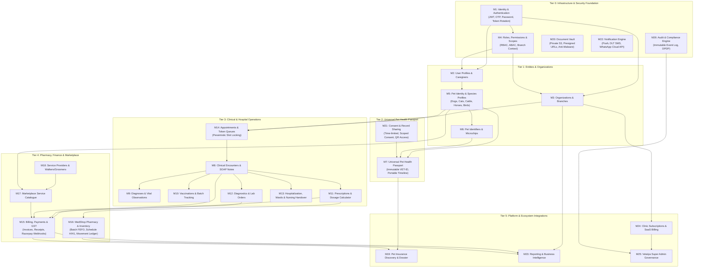

# Vetalya Feature Dependency Map & Module Graph

## 1. Module Hierarchy & Dependency Graph

---

## 2. Cross-Module Transactional Boundaries

| Trigger Event | Primary Module | Dependent Modules | Transactional Safety Mechanism |
| :--- | :--- | :--- | :--- |
| **Slot Booking** | `M14: Appointments` | `M15: Payments`, `M22: Notifications` | Database Pessimistic Lock on Slot ID + 10-minute hold Redis key to prevent double bookings. |
| **Encounter Finalization** | `M8: Encounters` | `M7: Passport`, `M10: Vaccinations`, `M11: Prescriptions` | Two-phase cryptographically signed snapshot; changes recorded as immutable revisions. |
| **Prescription Dispensation** | `M16: Pharmacy` | `M11: Prescriptions`, `M15: Billing` | DB Row-lock on `stock_batches`, updates batch quantity with FIFO/FEFO, inserts into `stock_movements`. |
| **Payment Confirmation** | `M15: Billing` | `M14: Appointments`, `M16: Pharmacy`, `M22: Notifications` | Webhook signature verification + idempotent key check; status transitioned inside single `@Transactional`. |
| **Record Share Approval** | `M21: Consent` | `M7: Passport`, `M26: Audit` | Grants time-limited permission token; every read event logged to `access_events` with timestamp and IP. |

---

## 3. Application-to-Module Mapping

| Application | Technology | Primary Consumed Modules |
| :--- | :--- | :--- |
| **1. Pet Parent Mobile App** | React Native (Expo, iOS & Android) | M1, M2, M5, M6, M7, M10, M14, M17, M19, M20, M21, M22 |
| **2. Vet Staff Mobile App** | React Native (Expo, iOS & Android) | M1, M3, M4, M5, M7, M8, M9, M10, M11, M12, M13, M14, M22 |
| **3. Veterinary Web Portal** | React / TypeScript | M1, M3, M4, M5, M7, M8, M9, M10, M11, M12, M13, M14, M15, M16, M20, M21 |
| **4. Clinic Admin Portal** | React / TypeScript | M1, M3, M4, M14, M15, M16, M23, M24, M26 |
| **5. Vetalya Super Admin** | React / TypeScript | M1, M3, M4, M17, M18, M19, M23, M24, M25, M26 |

