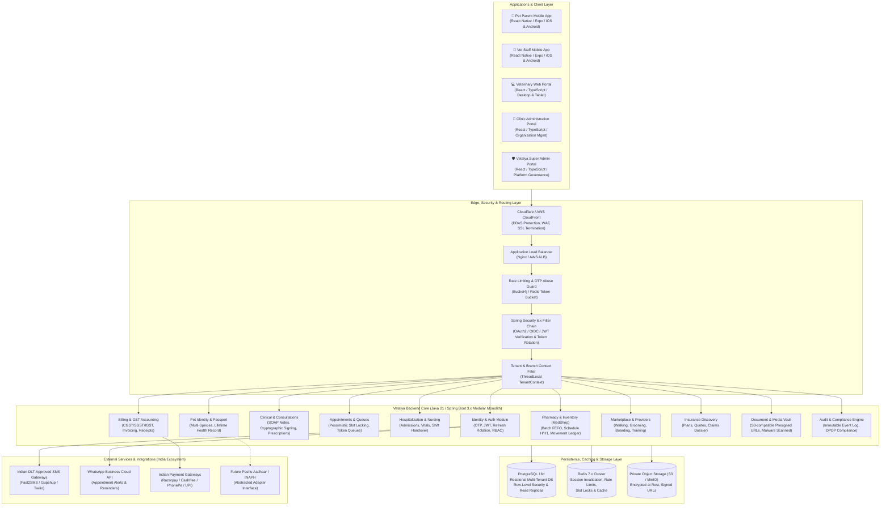
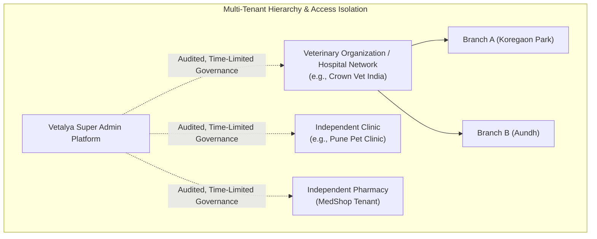

# Vetalya Platform — Complete System Architecture

## 1. Executive Summary & Product Vision
**Vetalya** (*"Every Pet's Health. Always."*) is a mission-critical, enterprise-grade veterinary healthcare ecosystem designed for India. The platform bridges pet parents, livestock caregivers, veterinary surgeons, clinic/hospital staff, diagnostic laboratories, pet pharmacy retailers, and pet care service providers under a unified digital umbrella.

### Core Architectural Tenets
1. **Single Source of Truth (Digital Pet Health Passport):** Every pet receives an immutable, globally unique Health Passport (`VET-ID`), decoupled from any single clinic or caregiver, enabling lifetime portable records while strictly enforcing veterinary signature immutability and owner consent.
2. **Modular Monolith First:** Built on Java 21 and Spring Boot 3.x with domain-driven boundary separation. Prevents microservice sprawl, simplifies distributed transactions (e.g., slot booking + payment confirmation, pharmacy inventory deductions + billing), while maintaining clean internal API boundaries for future extraction.
3. **Multi-Tenant & Role-Gated Security:** True multi-tenancy for veterinary clinics, multi-branch hospitals, and independent pharmacies (MedShop), combining Role-Based Access Control (RBAC), Attribute-Based Access Control (ABAC), tenant isolation, and caregiver-granted consent scopes.
4. **Resilient Unified Client Ecosystem:** 5 distinct interface applications consuming a unified, standardized RESTful `/api/v1` API with OpenAPI documentation, JWT/OAuth2 authentication with token rotation, and strict server-side validation.

---

## 2. Global Architecture Diagram

---

## 3. Brand Identity & Design System Standards

### Brand Palette
* **Primary Navy:** `#123F70` (Dominant brand anchor, navigation headers, primary buttons)
* **Secondary Navy:** `#0B315C` (Sidebar active states, deep text headers, dark mode surfaces)
* **Primary Teal:** `#079D96` (Primary interactive accents, success indicators, verified badges)
* **Dark Teal:** `#087D78` (Hover states, table header accents)
* **Paw Orange:** `#FF843F` (Emergency alerts, call-to-action highlights, vaccination due warnings)
* **Background Canvas:** `#F7F9FA` (High-legibility clinical light canvas)
* **Light Teal:** `#E8F6F4` (Card badges, health passport timeline nodes)
* **Light Blue:** `#EAF1F8` (Appointment cards, informational containers)
* **Main Text:** `#192A3A` (High-contrast charcoal body text)
* **Secondary Text:** `#718096` (Muted timestamps, secondary labels)

### Typography & Spacing
* **Display Font:** Plus Jakarta Sans / Inter (Headings, metric callouts)
* **Body Font:** Inter (Readable at 12px-16px across mobile and desktop)
* **Border Radii:** Rounded-2xl (`16px`) for cards and dialogs; Rounded-xl (`12px`) for buttons and form inputs. No overly playful cartoon shapes.
* **Elevations:** Subtle multi-layer shadows (`box-shadow: 0 4px 20px -2px rgba(18, 63, 112, 0.06)`).

---

## 4. Multi-Tenant Organization & Data Isolation Architecture

### Data Isolation Guarantees:
1. **Clinic/Hospital Level:** Every encounter, prescription, internal note, price list, inventory movement, and invoice belongs to a designated `organization_id` and `branch_id`.
2. **Passport Record Splitting:**
   - **Public/Caregiver Viewable:** Verified vaccinations, signed diagnosis summaries, dispensed medications, lab results (when explicitly published), and owner uploads.
   - **Private Clinic Internal:** Sensitive veterinary differential diagnoses, triage internal notes, and preliminary staff communications remain sequestered to the attending clinic unless explicitly released to the shared Health Passport.
3. **Cross-Tenant Prevention:** Spring Data JPA `@Filter` or Hibernate tenancy filter injected dynamically from `TenantContext.getTenantId()` and checked at the Spring Security method security boundary (`@PreAuthorize("@securityService.canAccessBranch(#branchId)")`).

---

## 5. Microservices Extraction Path
While Vetalya runs as a high-throughput Modular Monolith for operational simplicity, modules are decoupled using:
- **Spring ApplicationEvents** for domain events (e.g., `AppointmentConfirmedEvent`, `EncounterSignedEvent`, `InvoicePaidEvent`).
- **Strict Package Isolation:** Inter-module calls occur strictly via explicit Java interfaces (`com.pet.vetalya.pet.api.PetService`), never direct repository-to-repository dependencies.
- **Dedicated DB Schemas:** Logical schema segregation inside PostgreSQL:
  - `auth.*` / `public.*` (Identity, Organizations, Caregivers)
  - `pet.*` (Pets, Health Passport, Vaccinations, Microchips)
  - `clinical.*` (Encounters, Diagnoses, Treatments, Nursing, Wards)
  - `medshop.*` (Pharmacy inventory, Batches, Schedule H, Invoices)
  - `marketplace.*` (Providers, Listings, Bookings)
  - `audit.*` (Immutable tamper-evident audit logs)
When transaction volume justifies independent horizontal scaling, `medshop` and `marketplace` can be decoupled into microservices with zero database restructuring.
