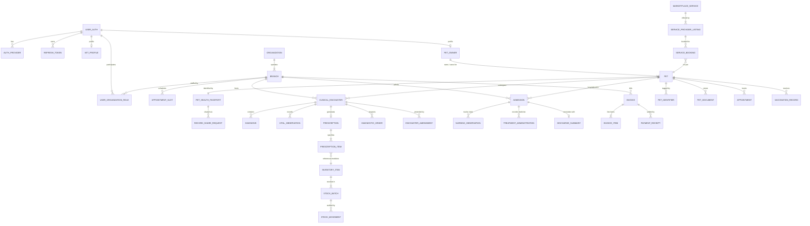

# Vetalya Database Schema, Entity Relationships & Migrations

## 1. Schema Design Principles
1. **Identities:** `VARCHAR(26)` (ULID - Universally Unique Lexicographically Sortable Identifier) or `UUIDv7` for high-performance sequential B-Tree indexing without UUID fragmentation.
2. **Audit Trails & Soft Deletes:** Every operational table contains `created_at TIMESTAMPTZ NOT NULL DEFAULT NOW()`, `updated_at TIMESTAMPTZ NOT NULL DEFAULT NOW()`, and `is_deleted BOOLEAN NOT NULL DEFAULT FALSE` where soft deletion applies.
3. **Medical Record Immutability:** Clinical encounter records, prescription revisions, invoice entries, and stock ledger movements cannot be updated or deleted in-place once signed/posted; corrections occur via auditable revision tables (`clinical_record_versions`, `credit_notes`, `stock_adjustments`).
4. **Tenant Isolation:** Multi-clinic and pharmacy entities maintain `organization_id` and `branch_id` (or `tenant_id` for MedShop) with compound foreign keys and indexes.

---

## 2. Entity Relationship Diagram (ERD)

---

## 3. Comprehensive Table Specifications

### Group A: Identity, Organizations & Permissions
* **`user_auth`** *(Existing V1)*: `user_id` (PK, ULID), `role` (PET_PARENT, VET, CLINIC_STAFF, ADMIN, etc.), `email`, `phone`, `password_hash`, `status`, `token_version`.
* **`organization`**: `org_id` (PK, ULID), `legal_name`, `trade_name`, `org_type` (CLINIC, HOSPITAL_CHAIN, PRACTICE), `gstin`, `pan`, `registered_address`, `verified_status` (PENDING, VERIFIED, REJECTED), `created_at`.
* **`branch`**: `branch_id` (PK, ULID), `organization_id` (FK), `branch_name`, `address_line1`, `city`, `state`, `pincode`, `geo_latitude`, `geo_longitude`, `emergency_24x7`, `operating_hours_jsonb`, `is_active`.
* **`user_organization_role`**: `id` (PK), `user_id` (FK), `organization_id` (FK), `branch_id` (FK, nullable for org-wide admin), `role_code` (VET_SURGEON, NURSE, TECHNICIAN, RECEPTIONIST, PHARMACIST, ACCOUNTANT, CLINIC_ADMIN), `is_active`.
* **`professional_credentials`**: `credential_id` (PK), `vet_user_id` (FK), `vci_registration_no` (Veterinary Council of India No.), `state_council_name`, `registration_year`, `qualification_degree`, `certificate_doc_url`, `verification_status`.

### Group B: Pet Identity & Universal Pet Health Passport
* **`pet`**: `pet_id` (PK, ULID), `owner_user_id` (FK `user_auth`), `passport_number` (`VET-IND-YYYY-XXXXX`, UNIQUE), `name`, `species` (CANINE, FELINE, EQUINE, BOVINE, CAPRINE, AVIAN, OTHER), `breed`, `gender` (MALE_INTACT, MALE_NEUTERED, FEMALE_INTACT, FEMALE_SPAYED, UNKNOWN), `dob`, `estimated_age_months`, `color`, `distinctive_marks`, `microchip_number` (UNIQUE, indexed), `avatar_url`, `is_deceased`, `created_at`.
* **`pet_identifier`**: `id` (PK), `pet_id` (FK), `identifier_type` (MICROCHIP, RFID_TAG, REGISTRATION_TAG, PASHU_AADHAAR_FUTURE), `identifier_value`, `issuing_authority`, `verified_by_vet_id`.
* **`pet_health_passport`**: `passport_id` (PK), `pet_id` (FK, UNIQUE), `blood_group`, `allergies_summary`, `chronic_conditions_summary`, `dietary_notes`, `public_emergency_qr_hash` (Expiring/Revocable token for physical pet collar tag).
* **`record_share_request`**: `request_id` (PK), `pet_id` (FK), `requester_user_id` (FK, e.g. second opinion clinic), `target_clinic_id` (FK), `scope` (FULL_TIMELINE, VACCINATIONS_ONLY, LAST_30_DAYS, EMERGENCY_SUMMARY), `status` (PENDING, APPROVED, REJECTED, REVOKED), `expires_at`, `approved_at`, `revoked_at`.

### Group C: Clinical Workspace & Patient Records
* **`clinical_encounter`**: `encounter_id` (PK, ULID), `pet_id` (FK), `branch_id` (FK), `attending_vet_id` (FK), `encounter_type` (OPD, EMERGENCY, SURGERY, HOME_VISIT, TELECONSULT), `chief_complaint`, `presenting_history`, `physical_examination`, `temperature_f`, `heart_rate_bpm`, `respiratory_rate_bpm`, `body_weight_kg`, `body_condition_score` (1-9), `assessment_notes`, `diagnosis_primary`, `differential_diagnosis_jsonb`, `treatment_plan`, `follow_up_date`, `is_signed` (BOOLEAN DEFAULT FALSE), `signed_at`, `digital_signature_hash`, `is_passport_published` (BOOLEAN DEFAULT TRUE), `created_at`.
* **`encounter_amendment`**: `amendment_id` (PK), `encounter_id` (FK), `amended_by_vet_id` (FK), `amendment_reason`, `prior_snapshot_jsonb`, `amended_content_jsonb`, `created_at`.
* **`vaccination_record`**: `vaccination_id` (PK), `pet_id` (FK), `encounter_id` (FK, optional), `vaccine_name` (e.g., DHPPiL, Rabies, Tricat, Anti-Rabies, FMD), `manufacturer`, `batch_number`, `route` (SC, IM, ORAL), `administered_on` (DATE), `next_due_date` (DATE), `administering_vet_id` (FK), `clinic_id` (FK), `vial_photo_url`, `verification_status` (VERIFIED_BY_VET, OWNER_ENTERED).
* **`prescription`**: `prescription_id` (PK, ULID), `encounter_id` (FK), `pet_id` (FK), `vet_id` (FK), `rx_date`, `instructions_notes`, `pdf_storage_url`.
* **`prescription_item`**: `item_id` (PK), `prescription_id` (FK), `medicine_name`, `generic_composition`, `dosage_form` (TABLET, SYRUP, INJECTION, SPOT_ON), `dose_amount`, `dose_unit` (mg, ml, drops), `frequency` (OD, BD, TID, QID, SOS, STAT), `duration_days`, `special_instructions` (e.g. "Post meals only, monitor water intake").
* **`diagnostic_order`**: `order_id` (PK, ULID), `encounter_id` (FK), `pet_id` (FK), `test_name` (CBC, Serum Biochemistry, Canine Parvo PCR, Ultrasound Abdomen, Digital X-Ray), `sample_type` (Whole Blood, Serum, Urine, Fecal swab, Tissue biopsy), `sample_collected_at`, `status` (ORDERED, SAMPLE_COLLECTED, PROCESSING, COMPLETED, REVIEWED, CANCELLED), `lab_technician_notes`, `report_pdf_url`, `reviewed_by_vet_id`.

### Group D: Hospitalization, Wards & Nursing
* **`admission`**: `admission_id` (PK, ULID), `pet_id` (FK), `branch_id` (FK), `admitting_vet_id` (FK), `ward_name`, `cage_number`, `admission_reason`, `critical_alert_level` (STABLE, MONITOR, ICU, CRITICAL), `admitted_at`, `discharge_status` (ADMITTED, DISCHARGED, TRANSFERRED, EXPIRED), `discharged_at`.
* **`nursing_observation`**: `obs_id` (PK), `admission_id` (FK), `recorded_by_nurse_id` (FK), `recorded_at`, `temperature_f`, `pulse_rate`, `respiration_rate`, `crt_seconds`, `mucous_membrane_color`, `fluid_intake_ml`, `urine_output`, `stool_consistency`, `clinical_care_notes`.
* **`treatment_administration`**: `admin_id` (PK), `admission_id` (FK), `scheduled_time`, `administered_at`, `administered_by_staff_id` (FK), `medicine_name`, `dosage_given`, `status` (ADMINISTERED, MISSED, REFUSED).
* **`discharge_summary`**: `discharge_id` (PK), `admission_id` (FK, UNIQUE), `authoring_vet_id` (FK), `hospital_course_summary`, `discharge_medications_jsonb`, `home_care_instructions`, `dietary_plan`, `emergency_warning_signs`, `follow_up_appointment_date`.

### Group E: Appointments & Token Queue
* **`appointment_slot`**: `slot_id` (PK, ULID), `branch_id` (FK), `vet_id` (FK), `slot_date` (DATE), `start_time` (TIME), `end_time` (TIME), `max_bookings` (DEFAULT 1), `booked_count` (DEFAULT 0), `is_blocked` (BOOLEAN DEFAULT FALSE), `version` (OPTIMISTIC LOCK).
* **`appointment`**: `appointment_id` (PK, ULID), `pet_id` (FK), `owner_id` (FK), `branch_id` (FK), `vet_id` (FK), `slot_id` (FK), `appointment_type` (GENERAL_CONSULT, VACCINATION, SURGERY_CONSULT, FOLLOW_UP, DENTAL, HOME_VISIT, EMERGENCY), `token_number` (INT), `status` (REQUESTED, CONFIRMED, CHECKED_IN, IN_CONSULTATION, COMPLETED, CANCELLED, NO_SHOW), `symptoms_description`, `cancellation_reason`, `created_at`.

### Group F: Billing, Invoicing & GST Accounting
* **`invoice`**: `invoice_id` (PK, ULID), `invoice_number` (`VET/PUN/2026-27/00142`), `branch_id` (FK), `customer_id` (FK), `pet_id` (FK), `subtotal_amount` (NUMERIC(12,2)), `cgst_amount`, `sgst_amount`, `igst_amount`, `discount_amount`, `net_payable_amount`, `payment_status` (UNPAID, PARTIAL, PAID, REFUNDED), `pdf_url`, `created_at`.
* **`invoice_item`**: `item_id` (PK), `invoice_id` (FK), `item_type` (CONSULTATION, PROCEDURE, MEDICINE, LAB_TEST, GROOMING), `description`, `hsn_sac_code`, `unit_price`, `quantity`, `gst_rate_percent` (0, 5, 12, 18), `total_amount`.
* **`payment_receipt`**: `receipt_id` (PK, ULID), `invoice_id` (FK), `gateway_order_id`, `gateway_payment_id` (Razorpay/UPI ID), `payment_method` (UPI, CASH, CARD, NETBANKING), `amount_paid`, `status` (INITIATED, SUCCESS, FAILED, REFUNDED), `verified_at`.

### Group G: MedShop Pharmacy & Inventory
* **`inventory_item`**: `item_id` (PK), `tenant_id` (FK), `trade_name`, `generic_name`, `hsn_code`, `category` (SCHEDULE_H, SCHEDULE_H1, OVER_THE_COUNTER, CONSUMABLE, VACCINE), `storage_condition` (ROOM_TEMP, REFRIGERATED_2_8C, FROZEN), `reorder_threshold`.
* **`stock_batch`**: `batch_id` (PK), `item_id` (FK), `batch_number`, `mfg_date`, `expiry_date`, `purchase_rate`, `mrp`, `selling_price`, `quantity_available`.
* **`stock_movement`**: `movement_id` (PK), `batch_id` (FK), `movement_type` (PURCHASE_RECEIPT, DISPENSE_SALE, TRANSFER_OUT, TRANSFER_IN, RETURN_EXPIRED, AUDIT_ADJUSTMENT), `quantity_delta`, `balance_after`, `reference_id` (Invoice ID or PO ID), `performed_by_user_id`, `timestamp`.

### Group H: Pet Care Services Marketplace
* **`marketplace_service`**: `service_id` (PK), `category` (PET_WALKING, GROOMING, BOARDING, TRAINING, RELOCATION), `service_title`, `description`, `base_price`, `pricing_unit` (PER_WALK, PER_SESSION, PER_DAY, PER_PACKAGE), `is_active`.
* **`service_provider`**: `provider_id` (PK), `user_id` (FK), `business_name`, `bio`, `kyc_status` (SUBMITTED, VERIFIED, REJECTED), `service_areas_pincodes_jsonb`, `average_rating`, `total_reviews`.
* **`service_booking`**: `booking_id` (PK, ULID), `service_id` (FK), `provider_id` (FK), `customer_id` (FK), `pet_id` (FK), `scheduled_date`, `time_slot`, `booking_status` (PENDING, CONFIRMED, SERVICE_IN_PROGRESS, COMPLETED, CANCELLED), `amount_paid`, `completion_notes`, `completion_photo_url`.

### Group I: Insurance Discovery & Dossier
* **`insurance_plan`**: `plan_id` (PK), `insurer_name`, `plan_name`, `species_eligibility`, `annual_limit_inr`, `coverage_summary_jsonb`, `waiting_period_days`, `brochure_pdf_url`.
* **`insurance_policy_dossier`**: `dossier_id` (PK), `pet_id` (FK), `user_id` (FK), `policy_number`, `insurer_name`, `premium_amount`, `commencement_date`, `expiry_date`, `policy_document_url`, `claim_history_jsonb`.
