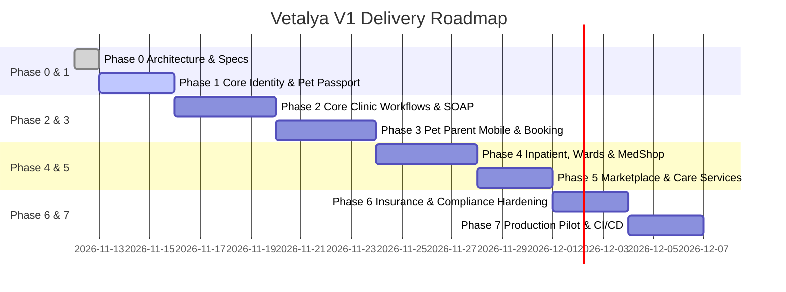

# Vetalya V1 Implementation Roadmap & Phase-by-Phase Execution Plan

## 1. Roadmap Overview & Phased Execution

---

## 2. Detailed Phase Breakdown

### Phase 0: Architecture, Discovery & Project Setup (Completed)
* Complete modular architecture definition (`docs/architecture/SYSTEM_ARCHITECTURE.md`).
* Feature dependency graph and cross-module boundaries (`docs/architecture/FEATURE_DEPENDENCY_MAP.md`).
* Comprehensive PostgreSQL schema and Mermaid ERD (`docs/database/DATABASE_SCHEMA_AND_ERD.md`).
* Full OpenAPI 3.1 REST API contracts (`docs/api/OPENAPI_SPECIFICATION.md`).
* 13-role RBAC & ABAC permission matrix (`docs/permissions/ROLE_PERMISSION_MATRIX.md`).
* Exhaustive 5-application screen inventory (`docs/architecture/SCREEN_INVENTORY.md`).
* Legal, clinical, and regulatory validation blueprint (`docs/architecture/LEGAL_CLINICAL_INTEGRATION_VALIDATION.md`).

### Phase 1: Core Platform Foundation (Identity, Pets & Pet Health Passport)
* **Identity & Authentication:**
  - Multi-role user model (Pet Parent, Veterinarian, Clinic Staff, Admin).
  - Production-grade DLT SMS/WhatsApp OTP service with rate limiting and replay prevention.
  - JWT token family rotation, secure refresh token revocation, session timeout guard.
* **Pet Identity & Caregiver Ownership:**
  - Universal pet entity supporting canine, feline, bovine, equine, caprine, avian, and other species.
  - Multi-caregiver association model (Primary owner + authorized co-caregivers).
  - Microchip, RFID, and physical identifier registration with vet verification status.
  - Deceased/archived state management preserving immutable medical history.
* **Digital Pet Health Passport:**
  - Unique persistent `VET-ID` generation (`VET-IND-YYYY-XXXXX`).
  - Core pet health passport view with blood group, allergies, chronic conditions, and emergency QR token.
  - Consent-controlled record share request and time-limited approval engine.
* **Document Vault:**
  - Presigned S3/MinIO upload and download URLs with MIME validation and size limits.
  - Document tagging by category (vaccination certificate, lab report, prescription).

### Phase 2: Core Clinic Workflows (Registry, Encounters, SOAP & Prescriptions)
* Clinic multi-branch organization registry and doctor scheduling.
* Patient check-in and waiting queue token management.
* Structured clinical encounter workspace (Chief complaint, TPR vitals, Body Condition Score, SOAP notes).
* Cryptographic record signing with immutable versioning and audit trail.
* Digital prescription generation with weight-based drug dose guidelines and Schedule H compliance.
* Diagnostic test order catalogue and report attachment.
* Core billing engine: itemized invoice generation with automated GST tax calculation.

### Phase 3: Pet Parent Application (Mobile & Responsive Web)
* Modern, uncluttered Pet Parent dashboard with pet switcher and quick action pills.
* Visual digital Pet Health Passport timeline displaying verified vs owner-uploaded records.
* Geo-proximity clinic search, filter by 24x7 emergency and species capability.
* Pessimistic transactional slot booking preventing double booking.
* Live appointment token tracking and check-in flow.
* Caregiver document camera capture and upload.

### Phase 4: Advanced Clinic Operations (Hospitalization, Wards & MedShop Pharmacy)
* Inpatient ward and cage management (ICU, General, Isolation).
* Nursing vital signs tracking sheet (temperature, CRT, hydration, fluid rates).
* Shift handover notes and attributable medication administration records.
* MedShop pharmacy module integration: batch FEFO stock movement ledger, low-stock alerts, and statutory Schedule H register.
* Financial reporting: daily revenue, cash collection, and tax export reports.

### Phase 5: Pet Care Services Marketplace
* Service catalogue management for dog walking, pet grooming, boarding, and training.
* Service provider onboarding and identity verification.
* Pincode-based provider availability, slot scheduling, and booking workflow.
* Walk completion tracking reports with GPS verification and photo proof.
* Verified client reviews and provider settlement ledger.

### Phase 6: Insurance Discovery, Integration Adapters & Compliance Hardening
* Pet insurance discovery directory and plan comparisons.
* 1-click insurance claim medical dossier export (compiled encounter notes, invoices, and diagnostic reports).
* Pashu Aadhaar livestock identifier abstraction layer for future DAHD/NDDB integration.
* Automated data retention and DPDP consent withdrawal mechanisms.

### Phase 7: Production Readiness, Security Verification & CI/CD
* End-to-end automated test suites for booking concurrency, payment webhooks, and security isolation.
* OWASP Top 10 API security validation, rate limiting, and SQL injection fuzz testing.
* Multi-stage Docker containerization and Docker Compose development stack.
* Automated Flyway migration verification in staging and production pipelines.
* Disaster recovery, automated daily database backup scripts, and restore drills.

---

## 3. Testing Strategy & Quality Acceptance Gates
Every feature is validated against three acceptance tiers:
1. **Unit & Isolation Tests:** All business logic, tax calculations, dosage mathematics, and state transitions tested in isolation (JUnit 5, Mockito, Vitest).
2. **Integration & API Contract Tests:** Full Spring Security mock MVC and real PostgreSQL testcontainers verifying authorization, tenant isolation, and Flyway migrations.
3. **End-to-End Workflow Verification:** Cypress / Playwright and React Native testing library ensuring user-facing screens properly display loading, empty, error, and permission-denied states.

